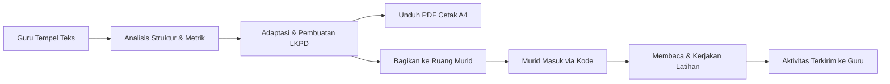

<div align="center">

# 📖 AksaraInklusi (ReadEase)
### *Platform Adaptasi Bacaan Inklusif & Ruang Literasi Ramah Disleksia*

[](https://fastapi.tiangolo.com/)
[](https://python.org)
[](https://reactjs.org/)
[](https://www.typescriptlang.org/)
[](https://vitejs.dev/)
[](https://tailwindcss.com/)

<p align="center">
  <b>Menjembatani akses literasi bagi setiap anak melalui adaptasi teks berbasis kebutuhan, antarmuka ramah disleksia, dan lembar kerja siap cetak.</b>
</p>

[Fitur Utama](#-fitur-utama) • [Tech Stack](#-teknologi-yang-digunakan) • [Panduan Instalasi](#-cara-menjalankan-proyek) • [Alur Kerja](#-alur-kerja-aplikasi) • [Dokumentasi Teknis](#-catatan--troubleshooting)

---

</div>

## 🌟 Tentang AksaraInklusi

**AksaraInklusi (ReadEase)** dirancang khusus untuk membantu guru dan orang tua dalam mendampingi anak-anak dengan kesulitan membaca, disleksia, maupun pembaca pemula. 

Aplikasi ini menganalisis struktur bacaan kompleks (300–800 kata), menghitung metrik keterbacaan, memberikan usulan penyederhanaan kalimat, serta menyajikan materi dalam format digital interaktif maupun lembar kerja fisik (**PDF A4 siap cetak**).

---

## ✨ Fitur Utama

### 👩‍🏫 1. Ruang Guru (Teacher Workspace)
- **Analisis & Adaptasi Teks**: Tempel materi bacaan, dapatkan analisis keterbacaan otomatis, pemenggalan frasa, dan deteksi risiko kebingungan kata.
- **Penyusun LKPD (Lembar Kerja Peserta Didik)**: Otomatisasi pembuatan soal latihan pemahaman bacaan dan kunci jawaban.
- **Manajemen Murid & Penugasan**: Kelola profil murid, bagikan tugas langsung ke ruang murid dengan kode unik tanpa memerlukan email siswa yang rumit.
- **Pemantauan Aktivitas**: Pantau progres dan hasil pengerjaan latihan murid secara real-time.

### 🎒 2. Ruang Murid (Student Hub)
- **Login Ramah Anak**: Cukup memasukkan kode pribadi dari guru tanpa perlu repot mengingat email dan kata sandi.
- **Pilihan Avatar Eksklusif**: Murid dapat memilih karakter avatar favorit untuk mempersonalisasi pengalaman belajarnya.
- **Tampilan Baca Ramah Disleksia**:
  - Pilihan tipografi ramah disleksia (OpenDyslexic / font sans-serif dengan spasi lebar).
  - Penyesuaian kontras latar belakang (kuning lembut, krem, gelap) untuk mengurangi stres visual.
  - Kartu baca per kalimat/paragraf dengan fokus terpandu.
- **Latihan Interaktif**: Mengerjakan soal langsung di layar dengan umpan balik visual yang menyenangkan.

### 🖨️ 3. Generator PDF A4 Siap Cetak (Print-Ready)
- Menghasilkan lembar bacaan siswa dan kunci jawaban guru dalam format PDF A4 hitam-putih presisi tinggi menggunakan Playwright.
- Standar tipografi cetak disesuaikan agar tetap jelas dan nyaman dibaca saat difotokopi.

---

## 🛠️ Teknologi yang Digunakan

| Komponen | Teknologi | Keterangan |
| :--- | :--- | :--- |
| **Frontend** | React 18, TypeScript, Vite | Antarmuka interaktif, responsif, dan aksesibel |
| **Styling** | Tailwind CSS & CSS Modules | Sistem desain adaptif dan ramah aksesibilitas |
| **Backend** | Python 3.12, FastAPI, Pydantic | REST API cepat, validasi data, dan logika segmentasi teks |
| **PDF Renderer** | Playwright (Chromium Headless) | Render dokumen cetak A4 presisi tinggi |
| **Database** | SQLite3 | Penyimpanan lokal ringan untuk akun guru dan aktivitas murid |

---

## 🚀 Cara Menjalankan Proyek

### Prasyarat
- **Python**: Versi 3.11 atau 3.12 ([Download Python](https://www.python.org/downloads/))
- **Node.js**: Versi 18+ atau 20+ ([Download Node.js](https://nodejs.org/))

---

### Jalankan di Windows (PowerShell)

1. **Clone repository ini** (atau buka terminal di folder project):
   ```powershell
   git clone https://github.com/<username>/aksarainklusi.git
   cd aksarainklusi
   ```

2. **Buat Virtual Environment Python:**
   ```powershell
   py -3.12 -m venv .venv
   ```

3. **Jalankan Setup Otomatis (Instalasi Dependensi & Build):**
   ```powershell
   .\.venv\Scripts\python scripts/run_local.py --setup
   ```
   > *Skrip ini akan otomatis memasang dependensi Python, Chromium untuk Playwright, paket npm frontend, melakukan build, dan menyalakan server.*

4. **Buka Aplikasi di Browser:**
   Kunjungi [http://127.0.0.1:8000](http://127.0.0.1:8000).

5. **Menjalankan kembali di lain waktu:**
   ```powershell
   .\.venv\Scripts\python scripts/run_local.py
   ```

---

### Jalankan di Linux / macOS

```bash
# 1. Setup virtual environment
python3 -m venv .venv

# 2. Jalankan setup otomatis
.venv/bin/python scripts/run_local.py --setup

# 3. Menjalankan di lain waktu
.venv/bin/python scripts/run_local.py
```

---

## 🔄 Alur Kerja Aplikasi



---

## 📂 Struktur Direktori

```text
aksarainklusi/
├── backend/               # Server FastAPI & Logika Adaptasi NLP
│   ├── app/
│   │   ├── main.py        # Titik masuk API FastAPI
│   │   ├── models.py      # Skema data Pydantic
│   │   ├── segmenter.py   # Segmentasi kalimat & kata
│   │   ├── pdf.py         # Generator PDF A4 via Playwright
│   │   └── worksheet.py   # Logika pembuatan soal & LKPD
│   └── tests/             # Pytest automated testing
├── frontend/              # Web App React + TypeScript + Vite
│   ├── src/
│   │   ├── components/    # Komponen UI (Avatar, Kartu Baca, dll.)
│   │   └── pages/         # Halaman Guru & Ruang Murid
├── docs/                  # Dokumentasi revisi, PRD, dan panduan akun
├── scripts/               # Skrip pembantu (run_local.py, verify_local.py)
├── README.md              # Dokumentasi utama proyek
└── README.old.md          # Catatan teknis pengujian & log revisi developer
```

---

## 🧪 Pengujian (Testing)

Proyek ini dilengkapi serangkaian pengujian otomatis:

```bash
# Uji Backend
cd backend && pytest -q

# Uji Frontend (Lint & Typecheck)
cd ../frontend && npm run lint && npm run typecheck
```

---

## 📑 Catatan & Troubleshooting

Catatan teknis lama, panduan pemulihan jika PDF gagal, serta log pengujian sebelumnya tetap diarsipkan dan dapat dilihat pada file:
👉 **[README.old.md](README.old.md)**

---

<div align="center">
  <sub>Dikembangkan dengan ❤️ untuk pendidikan inklusif yang lebih baik.</sub>
</div>
